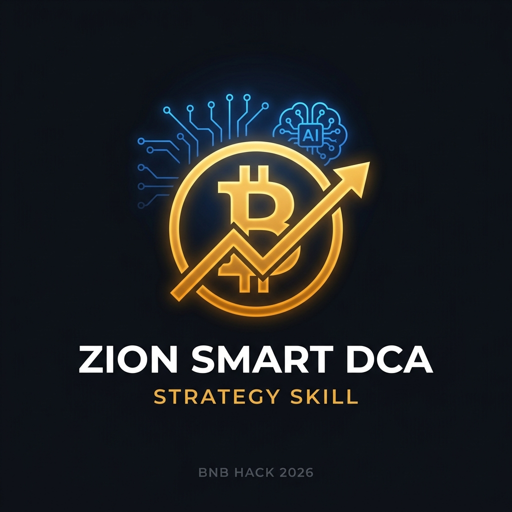

# Zion Smart DCA — BTC Accumulation Strategy Skill

<div align="center">



**An AI-powered CMC Skill that removes emotion from Bitcoin accumulation.**

[](https://dorahacks.io/hackathon/bnbhack-twt-cmc/)
[](#)
[](#)
[](#)
[](#)

</div>

---

## 🎯 Interactive Dashboard

**[→ Open the Zion Smart DCA v4.2 Dashboard](dashboard/index.html)** — live market data, real-time engine decisions, simulator, Meta Reversa Calculator, and full financial summary. No install needed — runs in any browser.

---

## The Problem

Most retail investors lose money not because they pick the wrong assets — but because they make emotional decisions at the worst possible times. Standard DCA is blind: it buys the same amount every period regardless of market conditions, wasting capital in greed phases and under-accumulating during fear events.

## The Solution

**Zion Smart DCA v4.2** is a 12-rule strategy skill powered by real-time CoinMarketCap data, built around **4 pillars** that adapt to the investor's reality:

> **💡 Flexibility First:** The strategy is SMART precisely because it adapts to YOU.
> Frequency is NOT fixed — choose daily, weekly, biweekly, or monthly.
> Amount is NOT fixed — $10, $50, $100, $500, whatever fits your budget.
> The F&G multiplier applies DIRECTLY to your full DCA base. No 70/30 split.

### Pillar 1 — Smart DCA (F&G Multiplier)

The F&G multiplier applies **directly** to your full DCA base amount. Surplus/deficit flows to and from the Buildup Reserve automatically.

| Signal | F&G Range | Multiplier | DCA (base $100) | Reserve Flow |
|--------|-----------|------------|-----------------|--------------|
| 😱 Extreme Fear | 0–24 | **2.0x** | $200 | Extra FROM Reserve |
| 😰 Fear | 25–44 | **1.5x** | $150 | Extra FROM Reserve |
| 😐 Neutral | 45–55 | **1.0x** | $100 | No movement |
| 😊 Greed | 56–74 | **0.75x** | $75 | Surplus TO Reserve |
| 🤑 Extreme Greed | 75–100 | **0.5x** | $50 | Surplus TO Reserve |

> **v4.2 Change:** No more 70/30 budget split. The multiplier applies to 100% of your DCA base. Surplus from greed periods flows directly to the Buildup Reserve. Deficit during fear is funded from the reserve.

### Pillar 2 — Buildup Reserve (Double-Layer Confirmation)

Buildup activates only when **both conditions** are met:
1. **RSI daily < 35** (oversold)
2. **Context filters pass** — at least one of: price above 200WMA, MVRV < 1.0, ATH drop > 50%

**Execution rules:**
- Max 3 orders per week
- Max 1 order per day
- 2.5% gap between limit orders
- Limit orders only (no market orders)

### Pillar 3 — Scaling Out (Dual Confirmation)

Scaling out requires **both**:
1. **RSI weekly > 70** (overbought on weekly timeframe)
2. **Secondary confirmation** — at least one of: Pi Cycle Top, MVRV > 7, BTC Dominance < 40%

- Sell 10–20% per signal
- Max 2 signals per month
- 14-day cooldown between sells

### Pillar 4 — Meta Reversa Calculator

Work backwards from your BTC goal. Set a target (e.g., 0.5 BTC), timeline (e.g., 4 years), and your weekly budget — the engine calculates exactly what you need, factoring in Smart DCA boosts, and shows how current market conditions accelerate or slow your progress.

---

## Proven Results

### 5-Year Backtest (2021–2026)

| Metric | Zion Smart DCA | Standard DCA | Buy & Hold |
|--------|---------------|-------------|------------|
| Total Return | **+55.4%** | +50.7% | +97.3% |
| Sharpe Ratio | **1.783** | 1.699 | 1.67 |
| Max Drawdown | **-44.58%** | -46.4% | -77.3% |
| Win Rate | **59.0%** | 59.4% | N/A |
| Profit Factor | **2.411** | 2.275 | N/A |
| Buildup Events | **29** | 0 | N/A |

> Zion Smart DCA outperforms Standard DCA by **+4.7pp** return with better risk-adjusted metrics (Sharpe 1.783 vs 1.699) and lower max drawdown.

### Live Period Simulation (Feb 13 – Jun 8, 2026 | Real Market Data)

Using **real Fear & Greed data** from [Alternative.me](https://alternative.me/crypto/fear-and-greed-index/) and real BTC prices from Yahoo Finance:

| Metric | Zion Smart DCA | Standard DCA |
|--------|---------------|-------------|
| BTC Accumulated | **0.0332329 BTC** | 0.023624 BTC |
| Extra BTC vs Standard | **+0.009609 BTC (+40.7%)** | — |
| Portfolio Value | $2,097 | $1,490 |
| Reserve Available | **$230 (ready to deploy)** | N/A |
| Buildup Events | **2** (F&G 23 + F&G 10) | N/A |

## Real-World Proof

This strategy has been live since **February 13, 2026** tracking real BTC purchases. The author applies the exact same 12 rules personally — the live simulation above reflects what those conditions looked like using real market data from that period.

## CMC Agent Hub Integration

The skill uses **5 CMC MCP tools** for real-time decision making:

```
get_global_metrics_latest       → Fear & Greed Index
get_crypto_technical_analysis   → RSI 14-period (BTC)
get_crypto_quotes_latest        → Current BTC price
get_upcoming_macro_events       → Macro context
trending_crypto_narratives      → Market sentiment
```

## Quick Start

```bash
git clone https://github.com/Fealtycripto/zion-smart-dca-skill
cd zion-smart-dca-skill
pip install -r requirements.txt
cp .env.example .env   # add your CMC API key

# Run a live decision (default: $100 weekly)
python src/zion_dca_skill.py

# Run with custom frequency and budget
python src/zion_dca_skill.py --budget 50 --frequency daily
python src/zion_dca_skill.py --budget 200 --frequency biweekly
python src/zion_dca_skill.py --budget 500 --frequency monthly

# Run 5-year backtest
python backtest/backtest.py --days 1825 --budget 100

# Open the interactive dashboard (no install needed)
open dashboard/index.html
```

## Project Structure

```
zion-smart-dca-skill/
├── SKILL.md                 ← CMC Skill playbook (official format)
├── dashboard/
│   └── index.html           ← Interactive v4.2 dashboard (standalone)
├── src/
│   ├── strategy.py          ← 12-rule strategy engine (v4.2)
│   ├── indicators.py        ← CMC Agent Hub integration
│   ├── zion_dca_skill.py    ← Main skill entry point
│   ├── agent.py             ← BNB AI Agent SDK (ERC-8004)
│   ├── commerce.py          ← ERC-8183 Agentic Commerce jobs
│   └── server.py            ← FastAPI job server (ERC-8183 endpoints)
├── backtest/
│   ├── backtest.py          ← Backtesting engine
│   ├── data_loader.py       ← Historical BTC data (2021-2026)
│   └── results_summary.json ← Full backtest results
├── scripts/
│   ├── analyze_multipliers.py  ← Multiplier analysis tools
│   ├── analyze_trades.py       ← Trade analysis
│   └── explore_cmc.py          ← CMC API explorer
└── docs/
    └── strategy_rules.md    ← All 12 rules explained
```

## The 12 Rules

1. **DCA Base** — fixed amount per period (daily/weekly/biweekly/monthly), no excuses
2. **RSI Buildup Trigger** — RSI < 35 + context filters (200WMA, MVRV, ATH%) activates Buildup mode
3. **F&G Multiplier Scale** — 0.5x to 2.0x applied directly to full DCA base (v4.2)
4. **Buildup Reserve** — surplus from greed periods flows to reserve; deficit in fear draws from reserve
5. **Never Sell Below PM** — never sell below average buy price (non-negotiable)
6. **Income Scaling** — extra income ÷ 4 = DCA increase
7. **BTC Floor (50%)** — portfolio never goes below 50% BTC
8. **Zero Leverage** — no margin, no futures, no exceptions
9. **Limit Orders Only** — Buildup buys use limit orders for best execution
10. **No Emotion** — system decides, not feelings
11. **Mandatory Logging** — every trade recorded with full context
12. **Monthly Review** — adjust budget, check reserve, verify allocation

## Black Swan Protocol

4 types of black swan events with specific responses:

| Type | Trigger | Response |
|------|---------|----------|
| 🔴 Exchange Collapse | Major CEX insolvency | Withdraw all to cold storage, halt DCA 7 days |
| 🟠 Regulatory Shock | Major country ban/restriction | Reduce position 50%, wait for clarity |
| 🟡 Flash Crash | BTC drops >30% in 24h | Deploy 100% reserve immediately |
| ⚫ Black Monday | Crypto + TradFi simultaneous crash | Full defensive — cash only for 14 days |

## Fiscal Layer

Brazilian tax optimization (R$35k monthly exemption threshold):
- Track monthly sell volume in BRL
- Alert when approaching R$35k limit
- Suggest splitting sales across months when possible

## Mission Milestones

| Marco | Target | Status |
|-------|--------|--------|
| 🥉 Bronze | 0.1 BTC accumulated | In progress |
| 🥈 Silver | 0.5 BTC accumulated | — |
| 🥇 Gold | 1.0 BTC accumulated | — |
| 💎 Diamond | 2.1 BTC (full coin + reserve) | — |

## Built With

- **Python 3.11** + pandas + numpy
- **CMC Agent Hub** (MCP Server — 5 tools)
- **BNB AI Agent SDK** (ERC-8004 on-chain identity)
- **yfinance** for historical BTC data
- **Chart.js** for interactive backtest visualization

## On-chain Identity (ERC-8004)

This agent is registered on **BNB Smart Chain Testnet** via the ERC-8004 standard.

| Field | Value |
|-------|-------|
| **Wallet** | `0x4E9feDB6DFb93fe7Ae98E2d2Bfe4fb6398A568bd` |
| **TX Hash** | [`0x5b36774865ad295891d898ccca74b88ded502a593fa5624d0671e1cf37afd558`](https://testnet.bscscan.com/tx/0x5b36774865ad295891d898ccca74b88ded502a593fa5624d0671e1cf37afd558) |
| **Network** | BSC Testnet (chain_id: 97) |
| **Standard** | ERC-8004 (Trustless Agent Identity) |

```bash
# Register agent on BNB testnet
python src/agent.py --register

# View agent identity card
python src/agent.py --info

# Start ERC-8183 job server
python src/agent.py --serve
```

## ERC-8183 Agentic Commerce

Zion Smart DCA exposes its analysis capabilities as **paid jobs** via the [ERC-8183](https://eips.ethereum.org/EIPS/eip-8183) Agentic Commerce standard. Other AI agents can discover, purchase, and consume DCA analysis through a standard REST API.

### Available Jobs

| Job Type | Description | Price |
|----------|-------------|-------|
| `analyze_market` | Real-time market analysis + DCA recommendation | $0.50 / 0.001 BNB |
| `backtest_period` | Historical backtest with performance comparison | $2.00 / 0.004 BNB |
| `portfolio_check` | Scaling Out analysis + milestone check | $0.25 / 0.0005 BNB |

### API Endpoints

| Method | Endpoint | Description |
|--------|----------|-------------|
| `GET` | `/health` | Server health check |
| `GET` | `/agent-card` | ERC-8004 agent identity card |
| `GET` | `/jobs` | List available job types (ERC-8183 catalog) |
| `POST` | `/jobs/analyze` | Execute market analysis job |
| `POST` | `/jobs/backtest` | Execute backtest job |
| `POST` | `/jobs/portfolio` | Execute portfolio check job |
| `GET` | `/jobs/{job_id}` | Query job status |

### Quick Start — Job Server

```bash
# Install dependencies
pip install -r requirements.txt

# Start the ERC-8183 job server
python src/agent.py --serve
# OR directly:
uvicorn src.server:app --host 0.0.0.0 --port 8000 --reload

# Open interactive docs
# http://localhost:8000/docs
```

### Example — Agent-to-Agent Request

```python
import requests

# 1. Discover available jobs
jobs = requests.get("http://localhost:8000/jobs").json()

# 2. Request market analysis
result = requests.post("http://localhost:8000/jobs/analyze", json={
    "budget_usd": 100,
    "frequency": "weekly",
    "btc_pct": 0.54,
}).json()

print(result["result"]["decision"]["decision"]["action"])  # "BUY"
print(result["result"]["decision"]["decision"]["multiplier"])  # 2.0
```

### ERC-8183 Flow

```
┌──────────────────┐    ┌─────────────────────┐    ┌──────────────────┐
│  Requesting Agent │──>│  ERC-8183 Escrow     │──>│  Zion Smart DCA  │
│  (any AI agent)   │   │  (on-chain payment)  │   │  (job provider)  │
│                   │<──│                      │<──│                  │
│  Receives result  │   │  Releases payment    │   │  Returns analysis│
└──────────────────┘    └─────────────────────┘    └──────────────────┘
```

## Author

**Rony Costa (Zion)** ([@Fealtycripto](https://github.com/Fealtycripto)), conhecido também como Fealty. Empreendedor, criador de conteúdo, fundador do [CriptoZion](https://criptozion.xyz) e criador da **Zion Smart DCA**, metodologia e projeto de software em evolução.

Versão editorial **BIO-1.0**. [Minicurrículo público](https://github.com/Fealtycripto/Fealtycripto/blob/main/MINICURRICULO.md). A revisão biográfica não altera a versão operacional ou as regras descritas neste repositório.

---

*Submitted to BNB Hack 2026 — Track 2: Strategy Skills*  
*CoinMarketCap × BNB Chain × Trust Wallet*
